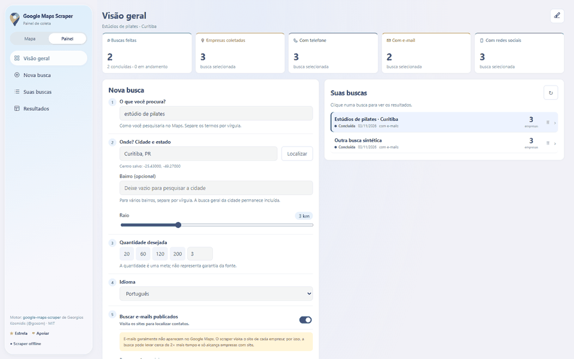
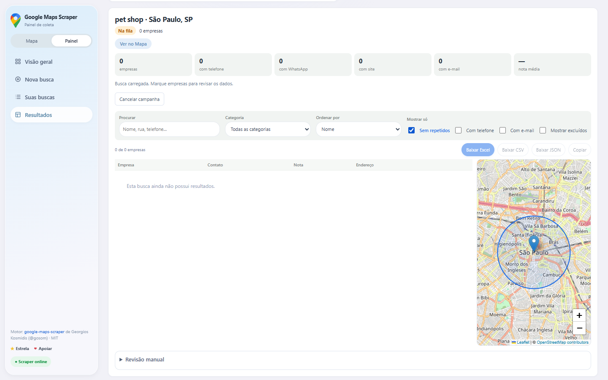
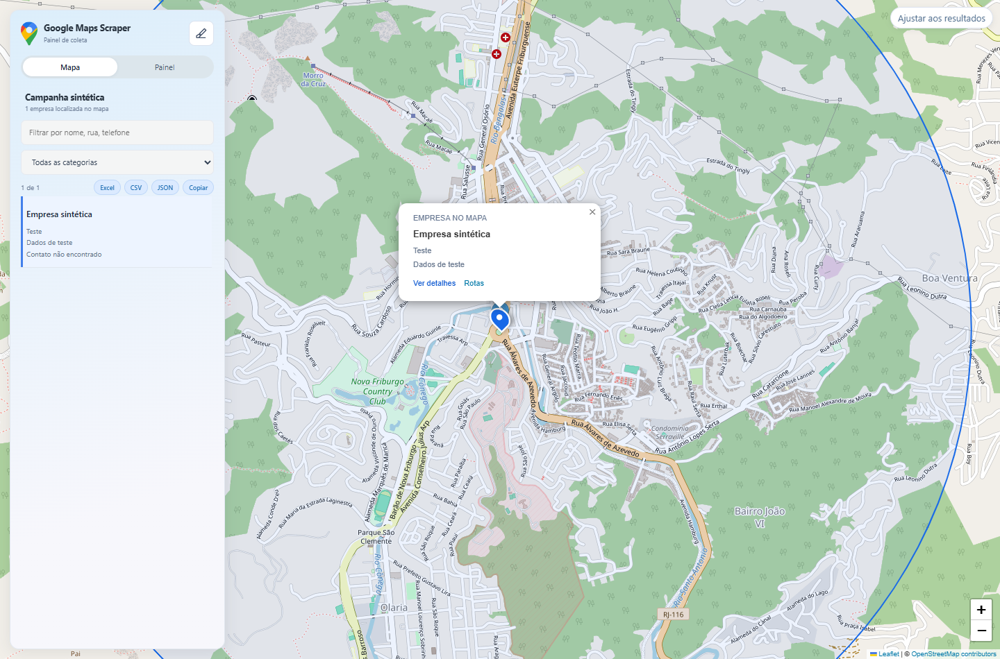
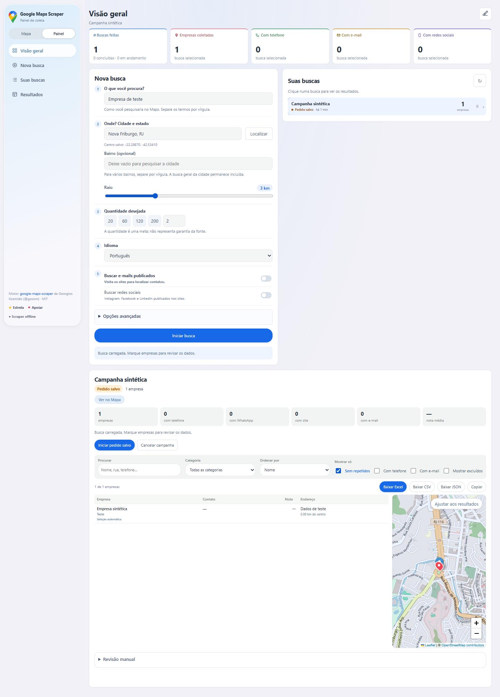
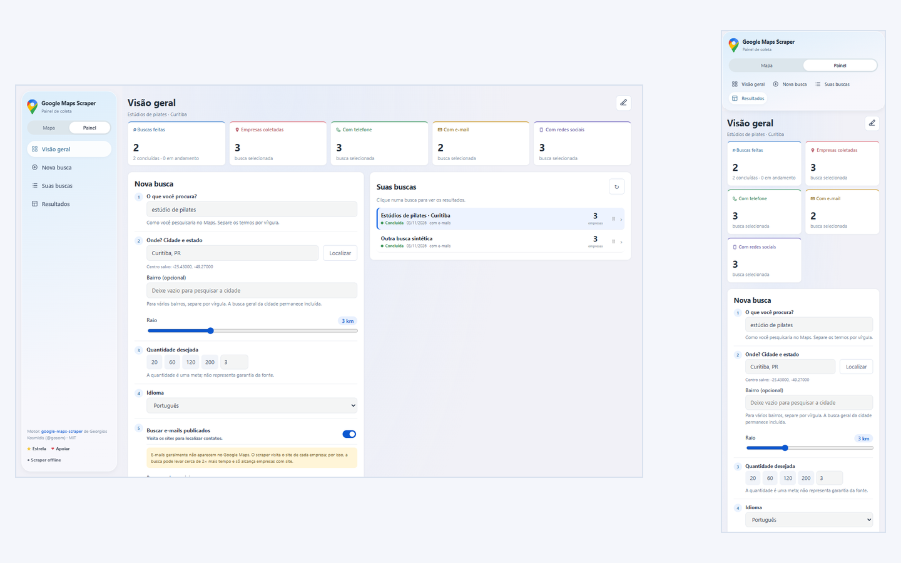

# Google Maps Scraper Kit


Google Maps Scraper Kit is a local application for collecting business listings from Google Maps, enriching them with institutional contact information published on company websites, and producing reviewable datasets in XLSX, CSV, or JSON.

I built the system around a local Python API, a persistent SQLite queue, a Docker-based Maps engine, and a web interface for campaign configuration, progress tracking, map inspection, review, history, deletion, and export.

The project is intentionally limited to companies and institutional information. It does not discover decision-makers, assign commercial scores, perform authenticated social-network scraping, send outreach, or depend on paid lead databases.

## Demo

<p align="center">
  
</p>

<p align="center">
  <em><strong>Demo.</strong> Recorded local run: a real search is configured, started, processed by the Maps engine, persisted, and opened in the result and map views.</em>
</p>

## Problem

Building a structured list of local businesses manually requires repeated Maps searches, website visits, contact extraction, duplicate removal, geographic checks, and spreadsheet cleanup.

The process becomes harder when the resulting list must remain auditable: missing fields must stay missing, sources must be preserved, partial failures must remain visible, and a later collection must not silently rewrite an older result set.

## Solution

Google Maps Scraper Kit turns a business segment, location, geographic area, and desired quantity into a persistent extraction campaign.

The system:

1. Plans one or more regional Maps queries.
2. Collects business listings through the installed Maps engine.
3. Normalizes and deduplicates observed companies.
4. Optionally visits public company websites for institutional contacts.
5. Applies explicit geographic and business filters.
6. Preserves the campaign and its evidence in SQLite.
7. Presents the results for map inspection and manual review.
8. Exports the complete, filtered, or selected result set.

The requested quantity is a target, not a guarantee. Availability depends on the external source, selected area, declared filters, and information each business publishes.

## Application Overview

<p align="center">
  
</p>

<p align="center">
  <em><strong>Figure 1.</strong> Real campaign in the local dashboard immediately after submission, with persisted status and map context.</em>
</p>

## Key Features

- **Regional search planning:** supports a confirmed center point, radius, automatic or explicit grids, configurable depth, bounded query budgets, and optional subdivision of saturated regions.
- **Explicit business matching:** filters Maps suggestions through literal business-name and category evidence, with configurable alternative category terms.
- **Institutional enrichment:** extracts published email addresses, additional phone numbers, and institutional social links from public company websites.
- **Protected website access:** respects `robots.txt`, validates public destinations and redirects, limits response size and duration, and does not authenticate or bypass blocks.
- **JavaScript fallback:** uses a constrained local Playwright process when contacts are missing and the page appears to require rendering.
- **Email-domain checks:** optionally evaluates public DNS/MX status without sending messages or claiming that a mailbox exists.
- **Deterministic filtering:** supports minimum rating and review counts, required fields, negative terms, radius checks, companies without websites, and optional exclusion of previous lists.
- **Persistent history:** stores campaign configuration, jobs, results, evidence, review state, coordinates, and frozen result snapshots in SQLite.
- **Map and review workflow:** displays saved companies geographically and keeps review, exclusion, and selection decisions scoped to each list.
- **Safe campaign deletion:** blocks deletion while jobs are running and preserves companies or evidence still shared by other campaigns.
- **Multiple export formats:** produces XLSX, UTF-8 BOM CSV, or JSON for an entire campaign or an explicit set of visible or selected company IDs.
- **Visible-result copy:** copies only the rows currently visible in the browser.
- **On-demand operation:** runs collections only after an explicit user action, without scheduled searches.

## Architecture

```text
Web interface / CLI / optional Codex chat
                    |
                    v
          Local HTTP API :8090
                    |
                    v
        SQLite campaigns and queue
                    |
              Serial worker
             /             \
            v               v
 Maps adapter :8081     Website adapter
            |           HTTP first
            v               |
 Docker-based Gosom         v
 Maps engine          Playwright fallback
             \             /
              v           v
         Normalization and deduplication
                    |
                    v
       Explicit filters and selection
                    |
                    v
       Review, map, history, and export
```

Python owns the application rules, campaign state, queue, filtering, persistence, and exports. The Maps browser remains inside the Docker engine, while website rendering uses a separate local Playwright process.

## How It Works

### 1. Campaign Planning

A campaign defines the business terms, location, target quantity, collection limit, language, and optional geographic center and radius.

Regional searches can use:

- a single query;
- an automatically selected grid;
- an explicit grid from `2 × 2` to `10 × 10`;
- optional subdivision of saturated regions;
- a bounded total query budget.

Overlapping regions are deduplicated. Results outside the declared radius do not consume the regional collection budget.

`target_count` limits the final deterministic selection after filters. `collection_limit` controls how many unique candidates are imported within the geographic area before contact-dependent filters are applied.

Neither value guarantees that enough matching businesses are available.

### 2. Maps Collection

The application processes Maps jobs serially through the installed Gosom-based engine.

Raw Maps output is written before import. The application then preserves supported business fields such as:

- name and category;
- address and location;
- primary phone and website;
- coordinates and place identifier;
- rating and review count;
- Maps URL;
- available institutional metadata;
- source and collection evidence.

Maps can return suggestions outside the intended segment. New campaigns therefore use explicit name and category matching before a company can be selected.

This matching is deterministic and literal. It is not semantic classification or commercial scoring.

### 3. Website Enrichment

Website enrichment is optional and limited to public institutional information.

The application attempts the supplied website and relevant same-domain pages such as contact, about, or team pages. It can extract:

- visible and obfuscated published email addresses;
- `mailto:` and institutional JSON-LD email values;
- published phone and WhatsApp values;
- institutional social links;
- `sameAs` links associated with organizations or local businesses.

Individual professional profiles are excluded. The application does not visit social profiles to identify people.

If regular HTTP retrieval does not expose the requested contacts and the page appears to require JavaScript, a constrained Playwright process may render it.

Sites that require authentication, external APIs, blocked third-party resources, or unavailable domains may remain incomplete.

### 4. Filtering and Review

The system applies only declared rules. It does not generate a commercial score or infer buying intent.

Supported controls include:

- business and category terms;
- geographic radius;
- minimum rating and review count;
- required website, phone, email, or social fields;
- companies without a known website;
- negative terms;
- exclusions from selected previous campaigns;
- optional DNS/MX verification.

Eligible companies are selected in deterministic name and ID order until the target is reached. Rejected results can be reviewed and restored without changing the original collected observation.

### Map and Result Review

<p align="center">
  
</p>

<p align="center">
  <em><strong>Figure 2.</strong> Persisted business results displayed on an interactive map alongside filters, tabular data, selection controls, and manual review actions.</em>
</p>

### 5. Persistence and Export

Each campaign is a distinct list identified by `campaign_id`.

When a campaign reaches a terminal state, its business view is frozen in SQLite. A later collection of the same company does not rewrite the older list's saved name, contacts, evidence, coordinates, or map point.

The operational database is stored at:

```text
data/google-maps-scraper-kit.db
```

Exports can be regenerated from persisted data without contacting Maps or company websites.

CSV files are written through a temporary file, filesystem synchronization, and atomic replacement so that a failed write does not overwrite the previous valid export.

### Saved Lists and Exports

<p align="center">
  
</p>

<p align="center">
  <em><strong>Figure 3.</strong> Real persisted results with XLSX, CSV, JSON, and visible-row copy actions enabled after collection.</em>
</p>

## Reliability and Engineering Decisions

| Mechanism | Purpose |
|---|---|
| Persistent SQLite queue | Keeps campaign and job state across application restarts |
| Lease and heartbeat | Detects interrupted workers and permits controlled recovery |
| Bounded retries and backoff | Prevents indefinite retry loops |
| Circuit breaker | Stops repeated failing operations |
| Idempotent campaign-company links | Prevents duplicate relationships during recovery |
| Frozen terminal snapshots | Stops later collections from changing closed lists |
| Atomic raw and CSV writes | Preserves the previous valid file when a write fails |
| Explicit partial state | Retains valid data while exposing inaccessible websites or incomplete steps |
| Source-level evidence | Keeps the observed value, URL, method, and date traceable |
| Serial Maps execution | Avoids competing engines and uncontrolled concurrency |
| Local host and Origin checks | Restricts the HTTP interface to its intended local context |
| Confirmation before deletion | Prevents an interface action from immediately removing a list |

Missing values remain empty.

A failed website request does not create an email address, confirm that no email exists elsewhere, or invalidate successful data from other sources.

## Security Boundaries

Website content is treated as untrusted data rather than executable instructions.

The institutional enrichment layer includes the following restrictions:

- public HTTP and HTTPS destinations only;
- ports `80` and `443`;
- no embedded credentials;
- public DNS validation;
- connections pinned to an approved public IP;
- redirect validation;
- `robots.txt` enforcement;
- response size limited to 1 MB;
- 10-second network timeout per operation;
- up to four page attempts per website;
- no authentication or CAPTCHA bypass.

Playwright rendering runs in a separate process with:

- a 20-second global rendering limit;
- up to 20 intercepted requests;
- same-domain GET requests only;
- protected Python fetching;
- Service Workers, WebSockets, downloads, media, images, and fonts blocked;
- child-process termination when the timeout is reached.

These controls intentionally limit compatibility with websites that depend on external APIs, authentication, or unrestricted third-party resources.

## Data and Export Model

Exports contain one row per company and may include:

- business identity and category;
- address, city, state, and coordinates;
- primary and additional phone numbers;
- website and published institutional email addresses;
- institutional social and messaging links;
- Maps identifiers and URL;
- review, filter, and selection state;
- source URLs and structured evidence;
- available Maps metadata;
- collection date and schema version.

Legacy personal and scoring columns remain empty where required for header compatibility. The current product does not populate personal or commercial-scoring data.

Spreadsheet-like values are protected against formula interpretation in tabular exports, while the original observations remain available in structured evidence.

The export endpoint supports:

```text
GET /api/v1/campaigns/{id}/export?format=csv
GET /api/v1/campaigns/{id}/export?format=xlsx
GET /api/v1/campaigns/{id}/export?format=json
```

Repeating `company_id` exports an explicit filtered or selected set. Without company IDs, the endpoint exports the complete saved list.

## Tech Stack

| Layer | Technology |
|---|---|
| Application and business rules | Python 3.12+ |
| Python package | `google_maps_scraper_kit` |
| Package and environment management | uv |
| Local API | Python standard-library HTTP server |
| Persistence and queue | SQLite |
| Website retrieval | Protected Python HTTP client |
| JavaScript rendering fallback | Playwright |
| Maps collection | Gosom-based Google Maps engine |
| Engine runtime | Docker Compose |
| Web interface | HTML, CSS, and JavaScript |
| Map | Leaflet and OpenStreetMap |
| Automated validation | Python `unittest` and browser smoke scripts |

The Python distribution and command-line entry point are named `google-maps-scraper-kit`.

## Repository Structure

```text
.
├── config/                         # Example business campaign configurations
├── data/                           # Local SQLite, raw jobs, backups, and reports
├── docs/                           # Architecture, contracts, audits, and validation records
├── infrastructure/engine/         # Local engine patch and Docker Compose overlay
├── integrations/
│   └── google-maps-scraper-kit/   # Preserved upstream Maps kit and its license
├── scripts/                        # Local startup and regional collection wrappers
├── src/
│   └── google_maps_scraper_kit/    # API, queue, adapters, filters, UI, and exports
├── tests/                          # Automated, browser, history, and opt-in live validation
├── ABRIR-APLICACAO.cmd             # Windows application launcher
├── PRD_GOOGLE_MAPS_SCRAPER_KIT.md  # Canonical product requirements
├── pyproject.toml
└── SETUP.md
```

Local databases, real contact data, exports, credentials, and live-validation artifacts must not be committed.

## README Media

The visual assets used in this README are stored in:

```text
img/
├── google-maps-scraper-kit-demo.gif
├── application-overview.png
├── map-and-review.png
├── history-and-exports.png
└── responsive-interface.png
```

The screenshots and GIF were recorded from deliberately small real Maps runs for documentation. They do not expose credentials, private datasets, or local development paths.

## Requirements

The documented local installation uses:

- Windows;
- Python 3.12 or newer;
- [uv](https://docs.astral.sh/uv/);
- Docker Desktop;
- local port `8090` for the application;
- local port `8081` for the Maps engine.

Docker and the Maps engine are required for new Maps collections.

Saved history, review data, map points, and regenerable exports remain stored locally and do not require a new collection.

## Installation

Install the Python environment:

```powershell
uv sync
uv run google-maps-scraper-kit init
```

Build the locally patched Maps engine using both Compose files:

```powershell
docker compose -f integrations/google-maps-scraper-kit/docker-compose.yml -f infrastructure/engine/compose.yaml build google-maps-scraper
docker compose -f integrations/google-maps-scraper-kit/docker-compose.yml -f infrastructure/engine/compose.yaml up -d
```

Both Compose files are required for the corrected engine image. Using the upstream Compose file alone returns to the original image without the local engine correction.

Do not run destructive volume cleanup if existing engine artifacts must be preserved.

The documented Windows setup uses the locally installed Edge channel for website rendering. Other platforms require a compatible Playwright browser installation, but cross-platform application compatibility has not been validated by this project.

See [SETUP.md](SETUP.md) for the complete installation and operational constraints.

## Usage

On Windows, run the application from the repository root:

```powershell
powershell -ExecutionPolicy Bypass -File scripts/start-local.ps1
```

Alternatively, open:

```text
ABRIR-APLICACAO.cmd
```

The launcher starts or reuses the API and worker, then opens:

```text
http://127.0.0.1:8090/
```

Opening the application does not schedule or automatically start a collection.

To start the API manually:

```powershell
uv run google-maps-scraper-kit serve-api --host 127.0.0.1 --port 8090
```

A campaign can also be managed through the CLI:

```powershell
uv run google-maps-scraper-kit create-campaign config/company-campaign.example.json
uv run google-maps-scraper-kit approve-campaign CAMPAIGN_ID
uv run google-maps-scraper-kit campaigns
uv run google-maps-scraper-kit results CAMPAIGN_ID
```

The API and web interface are the preferred operational flow.

Do not start additional workers or Maps engines in parallel against the same local state.

### Optional Natural-Language Operation with Codex

The web interface, Python API, worker, Maps engine, website enrichment, persistence, and exports work without an AI agent or model API.

Codex is an optional way to operate the same local application by chat. This repository includes [`AGENTS.md`](AGENTS.md) and the project skill at [`.agents/skills/google-maps-scraper-kit/SKILL.md`](.agents/skills/google-maps-scraper-kit/SKILL.md). They instruct Codex to translate a natural-language request into the existing local API contract instead of creating another scraper, worker, or database.

To use this mode:

1. Start the local application with `scripts/start-local.ps1`.
2. Open this repository in Codex Desktop or Codex CLI while signed in to your own Codex account.
3. Ask for a company search in natural language, including the segment, location, desired quantity, and whether to collect published emails or institutional social links.

For example:

```text
Use Google Maps Scraper Kit to find 50 dental clinics in Curitiba and include published institutional emails and social links.
```

Codex uses the user's own signed-in account only to interpret and operate the request. The collection itself is still executed locally by Python, Playwright, and the Docker-based Maps engine; it does not use Codex model credits to scrape each business.

The local HTTP API can also be integrated with another agent, but this repository currently provides and documents the ready-to-use agent instructions only for Codex. Authentication for any agent remains in that agent's own application and must not be stored in this project.

## API Overview

The local API includes routes for:

- health and runtime inspection;
- geocoding;
- campaign creation and history;
- explicit approval and cancellation;
- job pause and resume;
- result retrieval and review updates;
- campaign deletion;
- XLSX, CSV, and JSON export;
- usage and source-health inspection.

The complete route contract is documented in [docs/BACKEND_STATUS.md](docs/BACKEND_STATUS.md).

## Validation

Run the automated suite:

```powershell
uv run python -m unittest discover -s tests -v
```

Run the desktop and mobile browser smoke test:

```powershell
uv run python tests/browser_smoke.py
```

Run the independent saved-history browser scenario:

```powershell
uv run python tests/history_browser.py
```

The validation records dated November 3, 2026 report:

- 53 automated tests passing;
- desktop and mobile browser smoke tests passing;
- map, history, review, deletion, and filtered export behavior exercised;
- XLSX, CSV, and JSON exports exercised;
- JavaScript rendering and enforced timeout behavior exercised;
- list snapshots and exports preserved after API and engine restarts;
- SQLite integrity and foreign-key checks passing.

These checks validate the exercised behavior.

They do not prove uninterrupted external-source availability, universal website compatibility, complete geographic coverage, or a guaranteed business or contact volume.

### Desktop and Mobile Interface

<p align="center">
  
</p>

<p align="center">
  <em><strong>Figure 4.</strong> Responsive interface validated through desktop and mobile browser smoke tests, preserving campaign controls, navigation, and result visibility across screen sizes.</em>
</p>

### Recorded Live Validation

The final documented regional campaign reached its target of five topic-matching businesses. Three contained institutional social links, while no email address was recovered for that selected sample.

The campaign finished as `partial` because two websites were inaccessible. The Maps step itself completed, and the valid business results were preserved.

This result is intentionally reported as a constrained validation run, not as a throughput benchmark or a claim of complete market coverage.

See:

- [Web Validation](docs/VALIDACAO_WEB.md)
- [Regional Coverage and Institutional Extraction](docs/COBERTURA_EXTRACAO.md)
- [Persistent List History](docs/PERSISTENCIA_LISTAS.md)
- [Backend Status and Validation](docs/BACKEND_STATUS.md)

## External Dependencies and Boundaries

- New company collection depends on the installed Docker-based Maps engine and the availability of its external source.
- Website enrichment depends on public websites, DNS, `robots.txt`, and compatible page behavior.
- Map tiles and manual geocoding depend on their respective external providers and usage policies.
- No paid proxy, lead provider, or API-credit service is required by the documented default workflow.
- The application does not bypass CAPTCHA, authentication, source blocks, or access restrictions.
- PostgreSQL and Apache installations on the same host are not part of this pipeline.

## Known Limitations

- A radius constrains imported and selected results but does not prove that every business inside the circle was discovered.
- Maps may return businesses outside the requested segment; literal matching reduces this noise but is not semantic classification.
- Strict category matching can exclude relevant companies whose names and categories do not contain the expected terminology.
- Businesses without public coordinates cannot be confirmed as inside the radius.
- Website enrichment can remain partial for blocked, unavailable, authentication-dependent, or heavily cross-domain sites.
- DNS/MX checks evaluate the domain, not the existence or deliverability of an individual mailbox.
- Contact availability depends on what each organization publishes.
- Older campaigns remain read-only historical records and cannot be resumed as new extractions.
- Historical values overwritten before list snapshots were introduced cannot be reconstructed reliably.
- No recurring scheduler, hosted deployment, CI pipeline, or production uptime guarantee is documented.

## What This Project Demonstrates

- Local-first application architecture with explicit external boundaries
- Persistent job orchestration and restart recovery
- Evidence-preserving extraction and institutional enrichment
- Geographic planning, deduplication, and deterministic filtering
- Human review without hidden commercial scoring
- Immutable historical snapshots with regenerable exports
- Defensive network and browser-automation controls
- Transparent handling of partial results and unavailable data
- Compatibility-aware refactoring of a system with existing local history

## License

This project is available under the [MIT License](LICENSE).
